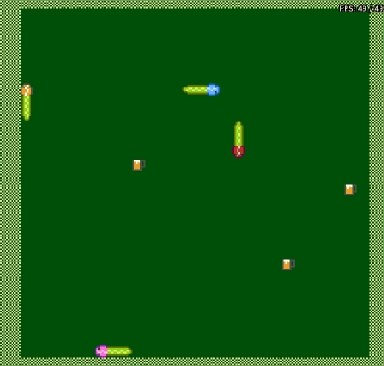

# 4 Player Snake Game
A 4 player battle royal snake game snake game made for the Nintendo Entertainment System (NES). Built entirely using 6502 assembly.

## Team Members
- Teun De Moor ([linkedin](https://www.linkedin.com/in/teun-de-moor-5423bb20a/))
- Bauwen De Ron ([linkedin](https://www.linkedin.com/in/bauwen-de-ron/))
- Mattias Simonts ([linkedin](https://www.linkedin.com/in/mattias-simonts-4552023a0/))

## Controls
- **D-pad**: moving your snake
- **A**: Navigating through menu's

## Playing
### Download a release
The easiest way to play is to download the latest `.nes` file from the [Releases page](https://github.com/BauwenDR/RetroProgramming/releases) and load it in your preferred NES emulator.

The game can also be played on original NES hardware, provided you have a way to run the `.nes` file.

The game is intended for a PAL NES running at 50 Hz, with a Four Score adapter enabled.

### Build and run from source
1. Clone or download this repository.
2. Install [Visual Studio Code](https://code.visualstudio.com/), [Mesen](https://www.mesen.ca/), and [CC65](https://cc65.github.io/).
3. Install the Alchemy65 extension for Visual Studio Code.
4. Open the project folder in Visual Studio Code.
5. If needed, update `launch.json` and `tasks.json` in the `.vscode` folder to match your local setup.
   For help setting up the compiler toolchain, see the [RetroProgramming template repository](https://github.com/BauwenDR/RetroProgramming-Template).
6. Run the project using the configuration in `launch.json`.
7. Before starting the game, make sure the emulator is configured for a PAL NES and has Four Score support enabled.

## Credits
- **Music**: We used some old Nokia ringtones for the music heard in game